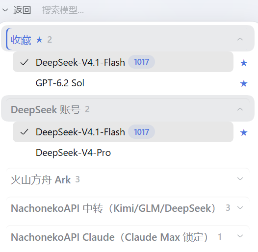
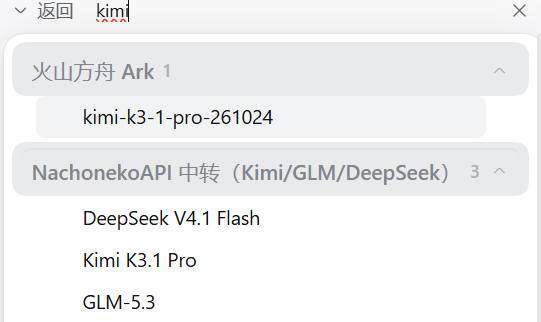

# dsh-model-picker-groups

给 DSH（DeepSeek Harness）对话框的模型选择器加上**按供应商分组折叠**、**常驻搜索**和**收藏**。

官方选择器把几十个模型平铺在一个长列表里，接了三五个中转站之后翻起来非常难受。这个插件顶替同一个插槽（`conversation.input.model`），保留官方外观与键盘操作，只改了列表的组织方式。

> 非官方项目。官方 DSH 仓库目前不接受外部 PR（见 [CONTRIBUTING.zh.md](https://github.com/deepseek-ai/deepseek-harness/blob/master/CONTRIBUTING.zh.md)），所以以独立插件的形式发布。

## 效果

| 默认：只展开当前供应商 | 搜索：常驻搜索框，命中自动展开 |
| --- | --- |
|  |  |

## 功能

- **分组折叠**：打开即只展开「当前模型所在的那组」，其余收起；点标题自由展开/收起，可同时展开多组。
- **常驻搜索**：打开菜单直接进模型列表并聚焦搜索框；搜索匹配模型名、模型 ID、分组名；命中即临时展开该组；Esc 三级阶梯（清空搜索 → 回到「模型 / 推理等级」根面板 → 关闭）。
- **顶部收藏**：空搜索时在最上方渲染「收藏」组，按 `路由 ID + 模型 ID` 保存（避免同名模型走错接入点），跨会话持久（`localStorage`）；收藏组本身也可折叠。
- **同名路由合并**：多个接入点用了同一个 `displayName` 时合并为一组，避免同款模型反复出现。
- **键盘与无障碍**：↑↓ / Enter / Esc / Tab 保留，`aria-expanded` / `aria-activedescendant` 与渲染行严格对应。
- **推理等级入口**：点底部推理等级徽标（如 `High`）直接进推理等级列表，再点一次收起。

## 同名路由合并规则

DSH 里「一把 key 一条路由」：同一个中转站接三把 key 就是三个 `llm-pi-ai` 路由，Host 目录按路由 id 分成三组。本插件按 `displayName` 合并（去首尾空格、忽略大小写）：

- 合并后组名取第一个路由的 `displayName`，组内模型数等于各路由之和；
- 每个模型行记住自己来自哪条路由，点选时提交的仍是那条路由——三把 key 可以显式挑，不是随机挑一个；
- 组内 **模型 id 重复**时行名追加 ` · <路由 id>`（如 `Kimi K3.1 Pro · my-route-alt`），否则两行肉眼无法区分；
- 没有 `displayName` 的路由回退为路由 id、单独成组、不参与合并。要让某条路由并进已有分组，先在 `cordis.patch.yml` 给它写上同样的 `displayName`。

## 兼容性

| 项目 | 要求 |
| --- | --- |
| DSH | `0.2.1-rc.3` 的 `dsh-client-ui-model-selection`（本插件由该版本构建产物 fork 而来） |
| 平台 | Web 客户端（桌面端 Electron 与浏览器端均可） |
| 浏览器内核 | Chromium 105+（用到 CSS `:has()`） |
| Node | ≥ 22（仅本地重建需要） |

DSH 升级后官方 bundle 变化会让重建失败（脚本报 region 校验错误），届时需要重新 `--emit` 并合并差异。

## 安装

### 1. 通过插件管理器安装（推荐）

`package.json` 现已声明 `dsh.bundle`，指向随包提供的 `cordis.patch.yml`。该补丁会禁用官方 `ui-model-selection` 并插入本插件，所以装上即接管，不需要再手工改 profile。尚未实测的是「桌面端插件管理器会不会自动应用这个 `bundle.patch`」——那是插件管理器自身的安装流程。

桌面端请在应用内 **设置 → 插件** 里安装仓库 `https://github.com/luoqiusang/dsh-model-picker-groups`；不要通过 CLI 修改 desktop profile，CLI 会报该 profile 由 Electron 管理。非 Electron 管理的 profile 可使用 `dsh plugin add` 安装该仓库。

当前尚未发布到 npm 或插件市场。离线或不能使用插件管理器时，按下面的手动方式挂载。

### 2. 手动 / 离线安装

把仓库放到 profile 的 `node_modules` 下，并在 profile 的 `cordis.patch.yml` 里禁用官方插件、插入本插件；`install.ps1` 是此方式的辅助脚本。

#### Windows

```powershell
git clone https://github.com/luoqiusang/dsh-model-picker-groups.git D:\path\to\dsh-model-picker-groups
powershell -NoProfile -ExecutionPolicy Bypass -File D:\path\to\dsh-model-picker-groups\install.ps1
```

`install.ps1` 做三件事：

1. 在 `%USERPROFILE%\.dsh\profiles\<profile>\node_modules\dsh-model-picker-groups` 建 junction 指向仓库；
2. 备份 `cordis.patch.yml`；
3. 追加一段用 `# >>> dsh-model-picker-groups` / `# <<< dsh-model-picker-groups` 包裹的补丁（幂等，重复运行只替换这段；若无标记段但已有 `name: dsh-model-picker-groups`，视为 bundle 已挂载并跳过追加）：

```yaml
- id: ui-model-selection
  disabled: true
- insert:
    - id: model-picker-groups
      name: dsh-model-picker-groups
```

保存后客户端会热重载插件，不需要重启 DSH。

#### 其它平台

在 `<DSH profile>/node_modules/` 下建符号链接指向本仓库，再手工写入上面那段 YAML。

`- id: ui-model-selection` 会命中原官方 bundle 里**嵌套**的条目——loader 的 patch 层按裸 id 扁平索引所有子条目，不必写出完整路径。

#### 手动安装的卸载

```powershell
powershell -NoProfile -ExecutionPolicy Bypass -File D:\path\to\dsh-model-picker-groups\uninstall.ps1
```

删除 junction 与该段补丁，官方选择器立刻恢复。

## 工作原理

`lib/client.js` **不是手写的**，而是「官方 bundle + 本地片段」拼接产物：

```text
app.asar 内的官方 client.js
  ├── 11 个 //#region（脚本按名字校验顺序）
  ├── 6 段：原样保留
  └── 5 段：用 src/ 下的文件整段替换
        src/css.js            ← 样式（折叠 / 收藏 / 返回键 / 分隔线）
        src/provider-order.js ← 同名路由合并
        src/ModelSelect.js    ← 组件主体（折叠、搜索、收藏、滚动）
        src/locales.js        ← 中英文案
        src/index-region.js   ← 插件注册与 /model 弹窗
```

`scripts/build.py`：解析 `app.asar` 头部 → 取出官方 bundle → 校验 11 段 region 顺序 → 替换 5 段 → 全局改名 → 写出 `lib/client.js`、`lib/index.js`、`package.json`、`cordis.patch.yml`。

```bash
python scripts/build.py            # 重建四个产物
python scripts/build.py --check    # 只校验：重放结果必须与 lib/client.js 逐字节一致
python scripts/build.py --emit     # 反向：把当前 lib/client.js 的 5 段抽回 src/
```

`app.asar` 位置查找顺序：`--asar <path>` → `DSH_ASAR` → `DSH_INSTALL` → 常见安装路径（`D:\dsh`、Program Files、`/Applications/…`、`/opt/…`）。找不到时脚本会列出试过的路径。

修改流程：改 `lib/client.js` → `--emit` 回写 `src/` → `--check` 必须 PASS → `node --check lib/client.js` → `node scripts/test-model-rows.mjs`（回归测试：行 id 分域、失败行不可选、IME 确认键、同名合并路由）。

为什么不用「直接改 `app.asar`」：它的 18,188 个条目**每条都带 integrity 校验**，改字节会破坏完整性校验；重打包则每次升级 DSH 都要重做。插件形式可逆、可热重载，也不用碰安装目录。

## 已知限制 / 未验证

- 输入法验收（未在真实 Windows 输入法上复现过）：输入拼音 → 按 Enter 确认候选词 → 菜单应保持打开、模型不应改变。
- `/model` 加载失败行仅作提示，不会切换模型；当前官方 `popupSelect` 不支持禁用行或取消成功关闭，点击提示行仍会由宿主关闭弹窗（待宿主提供拒选接口）。
- 依赖官方内部结构（region 标记、`MenuGroup` 的 `data-menu-group-*` 属性、`MenuSurface` 与 CSS 类名、slot 名），DSH 大版本升级必然要跟一次重建。
- 分组标题**不做吸顶**：吸顶需要不透明底色，而官方主题的强调色是 10% 透明 token，叠加「折叠导致的高度变化」会持续出现标题压住模型行、来回抢位，因此让标题随列表滚动。
- 收藏只能鼠标点击（收藏行可键盘选中模型，但星标本身不进 `itemRefs` 键盘序列）。
- `localStorage` 不可用时收藏只在本次会话内有效。
- 只改对话框选择器；`/model` 命令弹窗仍是官方渲染（但共享同名路由合并与收藏数据）。

## 致谢

- 官方实现：[deepseek-ai/deepseek-harness](https://github.com/deepseek-ai/deepseek-harness) · `packages/client/ui-model-selection`
- 同生态的其它选择器改造：`YMC521/dsh-model-groups`、`objectyan/dsh-model-picker-plus`、`ZoeHao2026/dsh-ui-model-selection-collapsible`

## 许可

MIT，见 [LICENSE](LICENSE)。`lib/client.js` 是官方 bundle 的衍生构建产物，来源与许可说明见 [THIRD_PARTY_NOTICES.md](THIRD_PARTY_NOTICES.md)。
